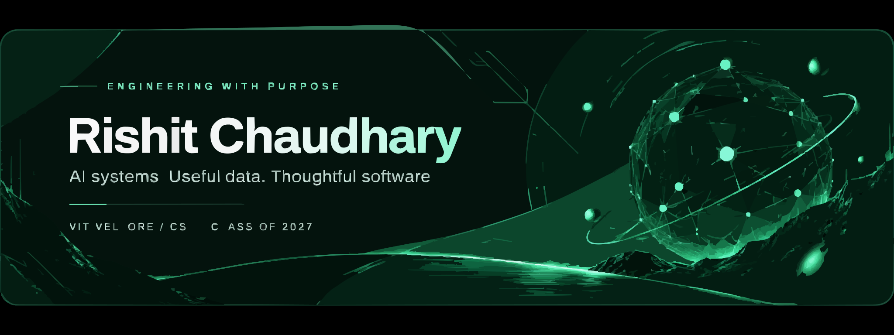

 

<a href="#about-me">About</a> &nbsp; / &nbsp; <a href="#tech-stack">Tech stack</a> &nbsp; / &nbsp; <a href="#projects">Projects</a> &nbsp; / &nbsp; <a href="#github-analytics">GitHub analytics</a>

## About Me

I'm a final-year **B.Tech CSE** student at **VIT Vellore**, graduating in **2027**. I work across **AI/ML, backend engineering and data systems**, with an interest in how technical decisions translate into useful products.

I enjoy the work around the model as much as the model itself: handling messy inputs, designing reliable APIs, keeping data consistent and making the whole system usable.

**Experience:** DS Group summer internship · Amazon ML Summer School '26  
**Exploring:** agentic workflows · retrieval-augmented systems · data products  
**Open to:** six-month internships and graduate opportunities

 

## Tech Stack

<b>&nbsp;Full breakdown by category</b>

 

**Languages & Core CS**
 

 

**AI / Machine Learning**
 

 

**Agentic AI & LLMs**
 

 

**Data Engineering & Analytics**
 

 

**Full-Stack & Cloud**
 

 

## Projects

Six builds across AI, software, data and connected systems. Open a repository for the architecture, implementation and setup.

<table>
<tr>
<td width="50%" valign="top">

<b>01 &nbsp; / &nbsp; AGENTIC AI</b>

<h3><a href="https://github.com/rizzit17/pharmassist">PharmAssist</a></h3>

<b>Complaint triage &amp; workflow automation</b>

A stateful, 10-node pipeline for complaint intake, intent routing, entity extraction and resolution workflows.

Python · FastAPI · LangGraph · PostgreSQL · Docker

<a href="https://github.com/rizzit17/pharmassist"><b>Explore repository ↗</b></a>

</td>
<td width="50%" valign="top">

<b>02 &nbsp; / &nbsp; APPLIED MACHINE LEARNING</b>

<h3><a href="https://github.com/rizzit17/O2R-Order-prediction">B2B Order Prediction</a></h3>

<b>Retail intelligence &amp; order forecasting</b>

Uses XGBoost and CatBoost to predict retailer ordering likelihood and help sales teams prioritize outbound calls.

Python · XGBoost · CatBoost · Pandas · Streamlit

<a href="https://github.com/rizzit17/O2R-Order-prediction"><b>Explore repository ↗</b></a>

</td>
</tr>
<tr>
<td width="50%" valign="top">

<b>03 &nbsp; / &nbsp; FULL-STACK ENGINEERING</b>

<h3><a href="https://github.com/rizzit17/seatzy">Seatzy</a></h3>

<b>Real-time event booking</b>

Atomic seat reservations, live seat selection, automated waitlist reallocation and QR-code ticketing.

React · TypeScript · PostgreSQL · Redis

<a href="https://github.com/rizzit17/seatzy"><b>Explore repository ↗</b></a> &nbsp; · &nbsp; <a href="https://seatzy-rishit17.vercel.app/"><b>Live demo ↗</b></a>

</td>
<td width="50%" valign="top">

<b>04 &nbsp; / &nbsp; IOT &amp; MACHINE LEARNING</b>

<h3><a href="https://github.com/rizzit17/SmartAgri">SmartAgri</a></h3>

<b>Sensor data → crop recommendations</b>

Streams field telemetry over MQTT and uses a Random Forest model to suggest crops from live sensor readings.

Python · ESP32 · MQTT · scikit-learn · Streamlit

<a href="https://github.com/rizzit17/SmartAgri"><b>Explore repository ↗</b></a>

</td>
</tr>
<tr>
<td width="50%" valign="top">

<b>05 &nbsp; / &nbsp; AI &amp; BACKEND SYSTEMS</b>

<h3><a href="https://github.com/rizzit17/helm">Helm</a></h3>

<b>A conversational finance copilot</b>

A mobile-first finance app for logging spending, asking questions, importing statements and exploring financial scenarios.

React Native · FastAPI · LangGraph · PostgreSQL · Redis

<a href="https://github.com/rizzit17/helm"><b>Explore repository ↗</b></a>

</td>
<td width="50%" valign="top">

<b>06 &nbsp; / &nbsp; DATA &amp; OPERATIONS</b>

<h3><a href="https://github.com/rizzit17/NexusFlow">DS NexusFlow</a></h3>

<b>Logistics analytics &amp; payout operations</b>

Turns payout workbooks into an interactive dashboard for rider summaries, reconciliation and operational insights.

Next.js · TypeScript · React · Zustand

<a href="https://github.com/rizzit17/NexusFlow"><b>Explore repository ↗</b></a>

</td>
</tr>
</table>

 

## &nbsp;GitHub Analytics

<table>
<tr>
<td valign="top" align="center">

</td>
<td valign="top" align="center">

</td>
</tr>
</table>

 

  

 

 

**Open to full-time roles, internships, and interesting builds - [let's talk](mailto:rishitwork28@gmail.com).**

